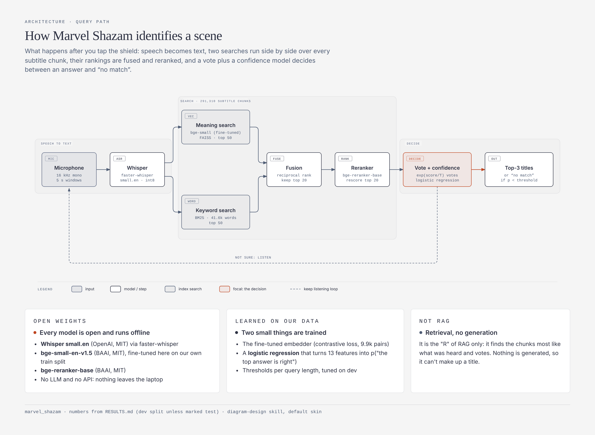
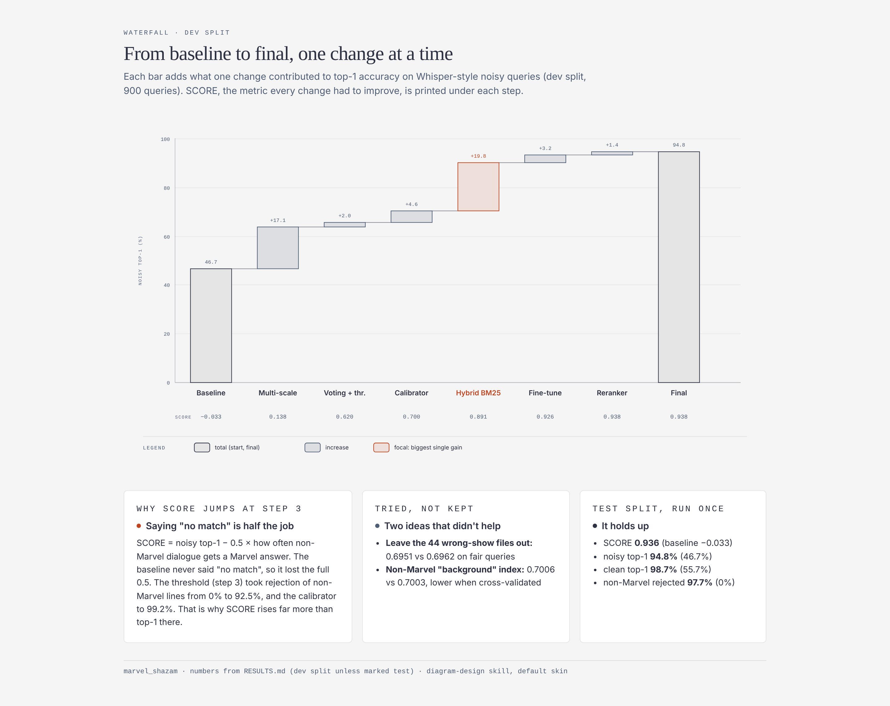
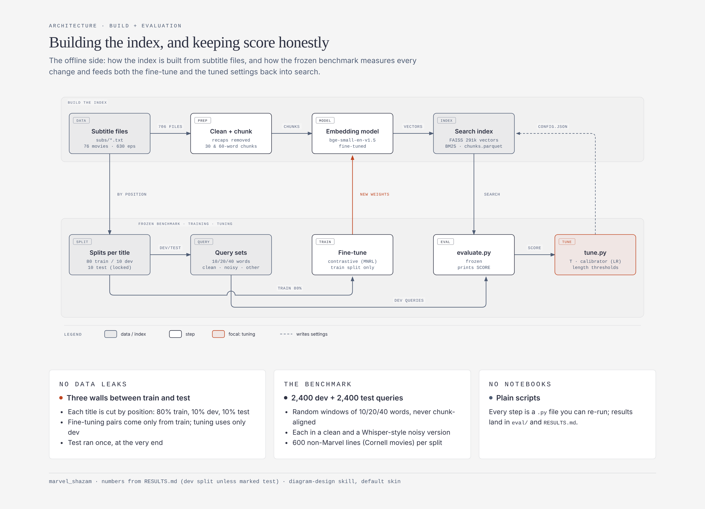

# Marvel Shazam

**Hold your laptop up to a Marvel movie or show and it tells you what you're watching.**

It listens to 5–15 seconds of dialogue, transcribes it with Whisper, and searches about 1,200 Marvel
movies and episodes (MCU, Netflix shows, the 1970s live-action series, and the X-Men and Spider-Man
cartoons). It answers with the top 3 titles, or "no match" when what it heard isn't Marvel.
Everything runs offline on a CPU, and no LLM is involved.

<!-- DEMO GIF: record ~15 s of the desktop app identifying a clip, save as docs/demo.gif, then uncomment:

-->

| | test split |
|---|---|
| Top-1 on Whisper-style noisy 10–40-word snippets | **92.6 %** |
| Correct title in the top 5 | **99.3 %** |
| Non-Marvel dialogue correctly rejected | **97.2 %** |

*Current catalog of 1,235 subtitle files, test split run once. See [Results](#results) for the full table.*

---

## How it works



1. **Speech to text.** `faster-whisper` (`small.en`, int8) transcribes 5-second windows from the mic.
2. **Two searches.** The transcript goes to a dense search (a fine-tuned `bge-small-en-v1.5` over FAISS)
   and to a BM25 keyword search. Both search every subtitle cut into overlapping 30-word and 60-word chunks.
3. **Fusion and reranking.** Reciprocal Rank Fusion merges the two rankings, and the cross-encoder
   `bge-reranker-base` rescores the top 20.
4. **Vote and decide.** The best chunks vote for their title. A logistic-regression calibrator turns
   13 features (vote margin, bigram overlap, BM25 score per word, similarity z-score, query length, …)
   into P(top answer is right). Below a threshold tuned for each query length, the answer is "no match".
5. **Keep listening.** If it isn't sure after 2 windows, it listens to a 3rd window before answering.

It's retrieval only. Nothing is generated, so it can't invent a title.

## Results

`SCORE = top-1 on noisy Marvel queries − 0.5 × false-accept rate on non-Marvel lines.`
Every change below had to raise SCORE on the dev split to be kept. The test split was locked
until the end.



### v1: one change at a time (706 subtitle files, 291k chunks)

| step | dev SCORE | noisy top-1 | clean top-1 | top-5 | non-Marvel rejected | kept |
|---|---|---|---|---|---|---|
| 0. Baseline: 60-word chunks, plain voting, no threshold | −0.033 | 0.467 | 0.561 | 0.722 | 0.000 | – |
| 2. Multi-scale chunks (30 + 60 words) | 0.138 | 0.638 | 0.754 | 0.859 | 0.000 | ✓ |
| 3. Sharpened voting exp(sim/T) + threshold | 0.620 | 0.658 | 0.809 | 0.861 | 0.925 | ✓ |
| 3+. Calibrated confidence + per-length thresholds | 0.700 | 0.704 | 0.859 | 0.861 | 0.992 | ✓ |
| – Drop 44 wrong-show subtitle files | 0.649 | 0.659 | 0.798 | 0.805 | 0.980 | ✗ |
| – Non-Marvel "background" index as a feature | 0.701 | 0.706 | 0.859 | 0.861 | 0.990 | ✗ |
| 4. Hybrid BM25 + dense (RRF) | 0.891 | 0.902 | 0.962 | 0.990 | 0.977 | ✓ |
| 6. Fine-tuned embedder (background hard negatives) | 0.926 | 0.934 | 0.982 | 0.991 | 0.983 | ✓ |
| 5. Cross-encoder reranker on top of 6 | 0.938 | 0.948 | 0.987 | 0.994 | 0.980 | ✓ |
| **Final config on TEST (run once)** | **0.936** | **0.948** | **0.987** | **0.994** | **0.977** | |

### v2: bigger catalog (1,235 subtitle files, 411k chunks)

I filled in the missing episodes (89 movies and 1,146 episodes now), removed repeated
"previously on" recaps, fine-tuned the embedder again (`bge-small-marvel-ft-v2`), retuned, and
regenerated the benchmark for the new catalog. The catalog grew by about 75 %, mostly with look-alike episodes, so the task is harder and the
v2 numbers aren't directly comparable with v1.

| split | SCORE | noisy top-1 | clean top-1 | top-5 | MRR | non-Marvel rejected | Marvel false-rejected |
|---|---|---|---|---|---|---|---|
| dev | 0.919 | 0.933 | 0.967 | 0.996 | 0.974 | 0.972 | 0.016 |
| **test** | **0.911** | **0.926** | **0.960** | **0.993** | **0.970** | **0.972** | **0.026** |

The hardest titles are the 1978 *Spider-Man* series, *Ultimate Spider-Man* and *X-Men: The Animated
Series*: long runs of episodes that share characters, catchphrases and recaps. Short 10-word noisy
snippets are the weakest bucket (86 % top-1 on test), which is why the app keeps listening when unsure.

Full per-step metrics and notes (CPU compromises, leakage checks, a known cleaning bug):
[RESULTS.md](RESULTS.md). Per-run summaries are in `eval/summary_*.json`.

## How it was evaluated



- Each title is split **by word position**: 80 % train, one 10 % block for dev, another for test.
  The index still contains all of the dialogue. The splits only decide where queries and training
  pairs come from.
- Queries are random 10-, 20- and 40-word windows, each in a clean version and in a **Whisper-style
  noisy** version (homophones, dropped words, broken punctuation).
- Negatives are non-Marvel movie lines from the Cornell Movie-Dialogs corpus.
- Fine-tuning pairs come only from the train blocks. Thresholds and the calibrator are fit only on dev.
  The test split was run once per version.

## Run it yourself

Subtitles are copyrighted, so they aren't in this repo. The downloader rebuilds the collection
from free subtitle providers.

```bash
pip install faster-whisper sentence-transformers faiss-cpu scikit-learn pandas pyarrow \
            requests sounddevice soundfile fastapi uvicorn pywebview

# 1. get subtitles (free API keys, see the header of fetch_missing.py)
python fetch_missing.py --dry-run
python fetch_missing.py

# 2. build the index (config.json controls chunking, model and search settings)
python build_index.py build
python build_index.py search "some line of dialogue"

# 3. benchmark: freeze splits, evaluate, tune, fine-tune
python prepare_eval.py
python evaluate.py --run baseline
python tune.py --config config.json --write
python finetune.py --config config.json --out models/bge-small-marvel-ft

# 4. the desktop app (mic -> Whisper -> search)
python app.py             # native window
python app.py --browser   # or in your browser
```

**Adding a franchise:** everything is driven by `config.json` → `sources`. `fetch_harry_potter.py`
downloads the 8 Harry Potter films into `subs_harry_potter/`. Add
`{"franchise": "harry_potter", "folder": "subs_harry_potter"}` to `sources` and rebuild. Only new
chunks get embedded.

## Repo map

| file | what it does |
|---|---|
| `build_index.py` | clean subtitles → chunk → embed → FAISS + BM25; the `Searcher` used everywhere |
| `prepare_eval.py` | builds the frozen dev/test benchmark (run once) |
| `evaluate.py`, `evaluate_stream.py` | frozen evaluator; keep-listening policy benchmark |
| `tune.py` | voting temperature, calibrator, per-length thresholds (dev only) |
| `finetune.py` | contrastive fine-tune of the embedder on train-split pairs |
| `build_background.py` | non-Marvel background index (hard negatives) |
| `app.py`, `app/static/` | desktop app: mic, Whisper, shield UI |
| `fetch_missing.py`, `subtitle_providers.py` | resumable subtitle downloader (Wyzie, SubDL, OpenSubtitles) |
| `data_check.py`, `missing_report.py` | data-quality reports → `DATA_CHECK.md`, `MISSING.md` |
| `docs/ANDROID_SPEC.md` | plan for an offline Android port |

## Roadmap

- **Name the scene, not just the title** ("Endgame, around 1:42:10"). The subtitle timestamps are
  already in the source files, so the cleaning step only has to keep them.
- **Public demo:** a Gradio app with mic input on Hugging Face Spaces, run without the reranker
  for speed on a free CPU (that setup scored 0.926 on v1 dev).
- Fix the `#` music-marker cleaning bug (see RESULTS.md, note 7) and regenerate the benchmark.
- An offline Android build ([spec](docs/ANDROID_SPEC.md)).

## Credits

Whisper (OpenAI) via faster-whisper · bge-small-en-v1.5 and bge-reranker-base (BAAI) ·
Cornell Movie-Dialogs corpus · sedthh/tv_dialogue · subtitle metadata from TVmaze and Wikidata.
Built by [Youssef Abdelkawy](https://github.com/YoussefAbdelkawy).
